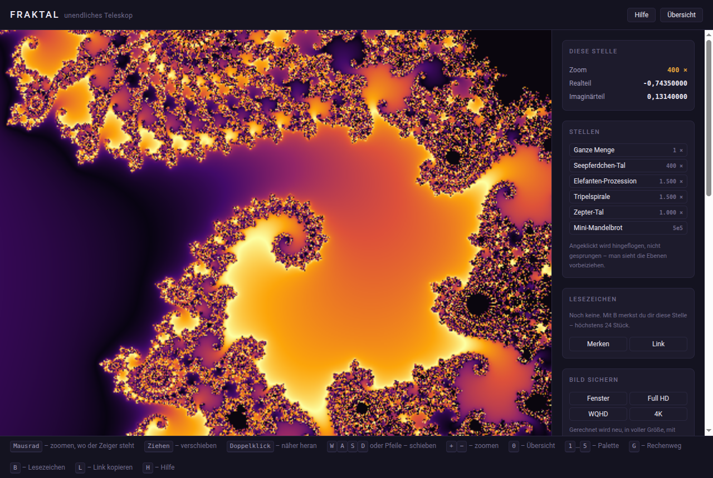

# FRAKTAL – unendliches Teleskop

Ein Teleskop in die Mandelbrot-Menge. Man fährt mit dem Mausrad immer weiter
hinein und kommt nie an ein Ende, weil auf jeder Ebene wieder neue Struktur
auftaucht.



## Loslegen

`index.html` doppelklicken. Mehr ist nicht nötig: kein Server, kein Build,
keine Installation. Die Seite lädt **nichts** aus dem Netz – keine Bibliothek,
kein CDN, keine Schrift, kein Bild. Gerechnet wird auf der Grafikkarte, der
Shader ist von Hand geschrieben.

Gebraucht wird ein Browser mit WebGL2 – aktueller Firefox, Chrome oder Edge.
Fehlt es, sagt die Seite das, statt schwarz zu bleiben.

## Was es kann

| | |
| --- | --- |
| **Zoomen** | Mausrad, und zwar dorthin, wo der Zeiger steht. Ziehen verschiebt, zwei Finger kneifen. |
| **Tiefe** | Ab einer Schwelle rechnet der Shader mit emulierter Doppelgenauigkeit weiter – statt bei Zoom 10⁴ ist erst bei rund 10¹¹ Schluss. |
| **Ehrlichkeit** | Die Seitenleiste zeigt, wie viele Dezimalstellen das Bild noch trägt. Wenn Schluss ist, steht das da, bevor das Bild matschig wird. |
| **Farbe** | Fünf Paletten, Regler für Dichte, Farbdrehung und Tiefe. |
| **Stellen** | Sechs berühmte Orte, angeklickt wird hingeflogen statt gesprungen. Eigene Lesezeichen mit Vorschaubild, Link zu jeder Stelle. |
| **Export** | PNG bis 4K, neu gerechnet mit doppelter Tiefe und Kantenglättung. |

Alle Tasten stehen in der Hilfe (**H**).

## Der technische Kern

Grafikkarten rechnen von Haus aus mit 32-Bit-Kommazahlen, also rund sieben
Dezimalstellen. Damit ist bei Zoom 10⁴ Schluss – das Bild wird stufig, weil
zwei Nachbarpixel auf derselben Zahl landen.

Deshalb gibt es FRAKTAL zweimal: einen schnellen Shader für oben und einen
mit **emulierter Doppelgenauigkeit**, in dem jede Zahl als Summe zweier floats
geführt wird (`js/shader/bausteine.js`). Das sind rund 14 Stellen und kostet
pro Multiplikation etwa das Zehnfache. Umgeschaltet wird automatisch, und zwar
nicht nach einem festen Zoomwert, sondern danach, wie viele Stellen der
einfache Weg an dieser Stelle und bei dieser Fenstergröße noch trägt.

In der Seitenleiste lässt sich der Rechenweg von Hand umstellen – tief drinnen
auf „einfach“ zerfällt dasselbe Bild in Klötzchen. Das ist der halbe Lernwert
des Projekts.

Ob die Emulation auf einer Grafikkarte wirklich greift, ist nicht
selbstverständlich: Sie lebt von Ausdrücken, die mathematisch null sind, und
ein Compiler darf die wegkürzen – auf einer hier getesteten Karte tat er es
vollständig. Dagegen steht in `js/shader/bausteine.js` an jeder kritischen
Stelle eine Multiplikation mit einer Eins, die der Compiler nicht kennt. **FRAKTAL misst deshalb beim Start nach**, wie
fein zwei Nachbarpixel auseinanderliegen dürfen, und rechnet mit dem
gemessenen Wert weiter. Was dabei herauskam, steht in der Seitenleiste unter
„Genauigkeit“. Sind die Zahlen am Ende, sagt das Bild es selbst – dann steht
die Warnung über der Leinwand und nicht im Kleingedruckten.

## Aufbau

```
index.html              Gerüst und die Reihenfolge der Skripte
css/                    variablen · grundlage · leinwand · oberflaeche
js/daten/               Paletten, Orte, Texte – Daten, kein Code
js/kern/                Zustand, Zahlaufteilung, Speicher, Adresse
js/gl/                  Kontext, Programm, Leinwand, Palettentextur,
                        Zeichenziel, Kacheln
js/shader/              Vertex, df64-Bausteine, Fragment-Shader
js/ansicht/             Kamera, Iterationen, Genauigkeit, Zeichner
js/ui/                  Seitenleiste, Farbwahl, Rechenmodus, Maus,
                        Tastatur, Orte, Lesezeichen, Verweis,
                        Export, Hilfe, Meldung
js/main.js              Einstieg und Bildschleife
pruefungen/             Node-Skripte und Browser-Prüfseiten
```

Kein `import`/`export`: die Seite muss per Doppelklick über `file://` laufen,
und Browser blockieren dort ES-Module. Stattdessen klassische `<script>`-Tags
in fester Reihenfolge, jede Datei hängt sich an `window.FRAKTAL`.

## Prüfen

```bash
for f in pruefungen/*.js; do node "$f"; done
```

Acht Node-Skripte mit rund 155 Einzelprüfungen, ohne Browser:
Kameramathematik, Eingabe gegen ein Stub-DOM, Grob-/Feinbild und die
zweistufige Notbremse mit gestellter Uhr, Palettentextur, Wahl des
Rechenwegs, Flug zu einer Stelle, Speicher samt voller Quote,
Kachelgeometrie.

Dazu drei Seiten, die im Browser nachmessen, was ohne Grafikkarte niemand
prüfen kann – einfach doppelklicken:


- `pruefungen/df64-nachmessen.html` – greift die Doppelgenauigkeit auf *dieser*
  Grafikkarte wirklich, oder hat der Shader-Compiler sie wegoptimiert? Zeigt
  dieselbe Messung, die beim Start läuft, Stufe für Stufe.
- `pruefungen/export-nachrechnen.html` – ergibt das gekachelte Bild dasselbe
  wie eines aus einem Stück?
- `pruefungen/orte-ansehen.html` – stehen im Seepferdchen-Tal wirklich
  Seepferdchen? Das lässt sich nicht ausrechnen, nur ansehen.

## Wo nichts hingeht

Die Seite schickt nichts ins Netz. Lesezeichen, der letzte Stand und die
Regler liegen im `localStorage` des Browsers, sonst nirgends. Ein Link mit
`#re=…&im=…&zoom=…` ist die einzige Art, eine Stelle weiterzugeben – und auch
der wird nur auf Zuruf erzeugt.

Der Rechenweg (automatisch / einfach / doppelt) wird mit Absicht **nicht**
gemerkt: er ist ein Werkzeug zum Vergleichen, und einmal auf „einfach“
stehengelassen wäre jedes tiefe Bild beim nächsten Öffnen stufig.
